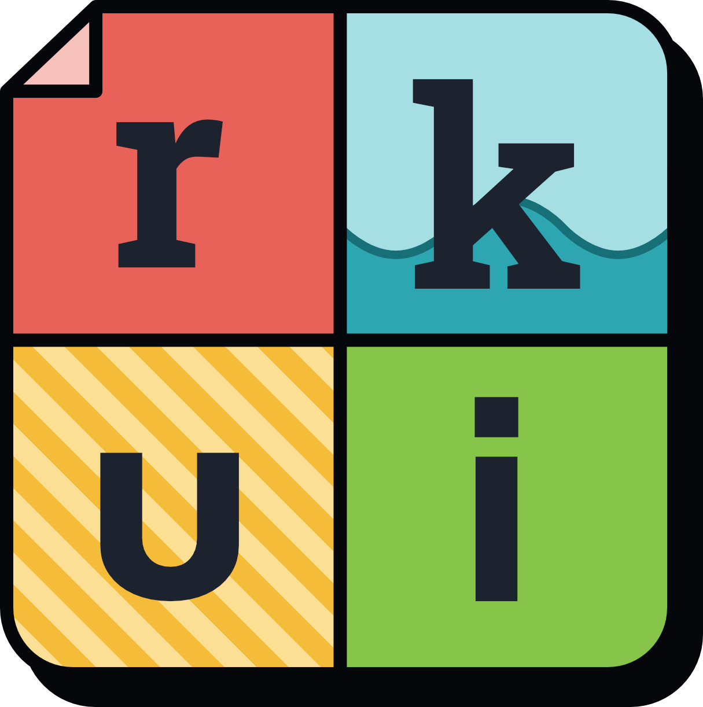

# rkui

Rob King's "toon" component library. It covers flat token colours, 2px ink outlines, hard shadows that
follow a light direction, a hover-lift/press-sink "pop", light/dark themes, page palettes, shadow
modes and a depth mode. It is built to plug into Astro, Vue and plain HTML sites.

Published on npm as `@oneonefour/rkui` (not yet released).

## What's where

| Folder | What it is | Ships to sites? |
|---|---|---|
| `src/` | The library itself, one folder per component under `components/` (its Vue component, its CSS, and the `*-element.ts` that registers its custom element if it has behaviour), with `tokens/`, `base/` (fonts, type, base styles), `shared/` (helpers more than one component uses), `head-scripts/` (scripts to paste inline into `<head>`), `fonts/` and `icons/` (the icon set and sources) | yes |
| `astro/` | The Astro integration, `@oneonefour/rkui/astro`: fenced code in MDX as CodeBlock, and dollar maths as Maths and Equation. It sits outside `src/`, which never imports Astro | yes |
| `site/` | The docs and demo site: every component, with the theme, palette and shadow switches. An Astro app that imports the library as `@oneonefour/rkui/...`, as any site would | no |
| `build/` | Node scripts that build `dist/`: the bundled CSS and JS, the type declarations and the icons | no |
| `dist/` | The build output (not committed): `rkui.css`, `rkui.js`, `colors.js` (the colour tokens' light and dark hex values, for places CSS can't reach, such as a canvas), `fonts/`, `icons/`, `types/` | yes |
| `docs/` | The design language (`DESIGN.md`) and the decision record (`DECISIONS.md`) | no |
| `pptx/` | The PowerPoint template generator | no |

## Commands

```sh
npm install
npm run build       # builds dist/, then type-checks and builds the docs site into site/dist/
npm run dev         # builds dist/, then runs the docs site live on port 4321
```

## Using the Vue components in Astro

Some peers are optional, so npm doesn't install them for you: `shiki` (`^4.0.0`) for CodeBlock's
highlighting, `katex` (`^0.19.0`) for Equation and Maths, and `astro` with `@astrojs/mdx` for the
Astro integration. The integration renders fenced code in MDX as CodeBlock and `$…$`/`$$…$$` as
Maths and Equation; add it with `import rkui from '@oneonefour/rkui/astro'` and
`integrations: [mdx(), vue(), rkui()]` in the site's Astro config.

Add `@astrojs/vue` to the site, with an app entrypoint that sets
`app.config.throwUnhandledErrorInProduction = true` (as `site/src/vue-app.js` does). Without it, a
component that throws while the site builds, such as a Folder with no Tab, is left out of the page
and the build still passes.

Add this line to the site's `src/env.d.ts`, so `astro check` accepts the form and link attributes
(`name`, `disabled`, `href`) that rkui components hand on to their native elements:

```ts
/// <reference types="@oneonefour/rkui/astro-attributes" />
```

Some components have a small helper script, a `*-enhance.js` file beside the component or the
CSS it serves: a browser fallback (the "more" dots and the sidebar in Safari and Firefox), or a
small extra the component works without (Pagination's scrollbar, the Table's entrance).
`src/enhance.js` imports every one, and a site loads them all with one line in its layout:

```astro
<script>
  import '@oneonefour/rkui/enhance.js'
</script>
```

`dist/rkui.js` includes them for plain HTML pages.

## Start here

- `docs/DESIGN.md`: the design language: how it looks and behaves, and why.
- `docs/DECISIONS.md`: when each design call was made, and the questions still open.
- `docs/ELEMENTS.md`: how a custom element is written here, step by step.
- `pptx/`: the PowerPoint template generator in the same style.
- `CLAUDE.md`: the rules every agent follows here.
